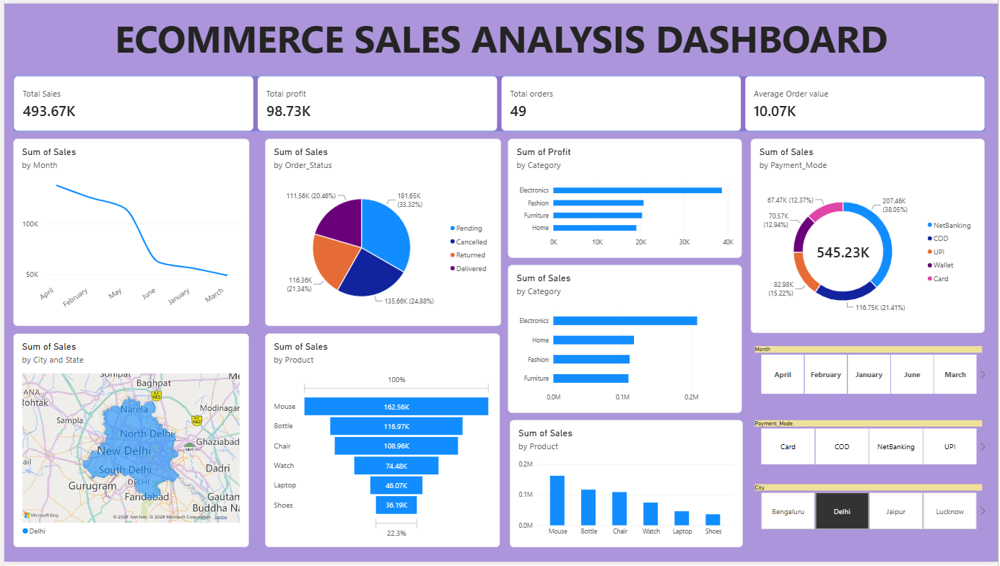

# E-commerce Sales Analysis Dashboard

An end-to-end data analytics portfolio project using **Python (Pandas)** for data preparation, **MySQL** for exploratory SQL analysis, and **Power BI** for an interactive sales dashboard.

## Power BI Dashboard Preview

## Project workflow
1. Start with an unclean e-commerce Excel dataset.
2. Inspect and clean records using Python/Pandas in Jupyter Notebook.
3. Export the prepared data to CSV.
4. Import the CSV into MySQL and run analysis queries.
5. Visualize KPIs, sales trends, products, categories, locations, order status, and payment modes in Power BI.

## Dashboard features
- Total sales, estimated profit, order count, and average order value cards
- Sales by month, product, category, payment mode, and order status
- Profit by category and city-level sales map
- Interactive month, payment-mode, and city slicers

## Repository files
- `AJAY.pbix` — Power BI dashboard
- `Ecommerce_data_analysis_and_cleaning.ipynb` — Python cleaning notebook
- `Ecommerce_Unclean_Project.xlsx` — original input dataset
- `Clean_Ecommerce.csv` — exported prepared dataset
- `ecommerce_sales_analysis.sql` — MySQL analysis queries
- `Steps of Cleaning.docx` — project notes
- `Screenshots/dashboard.png` — dashboard preview

## How to run
1. Open the notebook and update the Excel file path if needed; run the cleaning cells.
2. In MySQL, create a database (e.g. `ecommerce`) and import `Clean_Ecommerce.csv` into a table named `orders`, using CSV headers as column names.
3. Run `ecommerce_sales_analysis.sql` in MySQL Workbench.
4. Open `AJAY.pbix` in Power BI Desktop and update its data source path/connection if needed.

## Data notes and limitations
- The supplied CSV has **380 rows**, including missing order dates, order IDs, and sales amounts. The cleaned file should not be described as completely free of missing values.
- `Sales` is gross sales before discounts; `Net_Amount` reflects discounts. `Profit` is calculated as **20% of Net_Amount**, an assumption rather than measured profit.
- Cancelled and returned orders appear in the dataset. SQL includes both all-status and delivered-only analysis.
- The supplied dashboard screenshot shows KPI values that do **not** equal totals across the full supplied CSV. Check report filters, measures, and source versions before publishing numeric findings.
- SQL queries are provided for reproducibility and practice; they have not been executed against a live MySQL database here.

## Skills demonstrated
Python, Pandas, data cleaning, feature engineering, SQL, aggregation, KPI analysis, Power BI, and data visualization.
